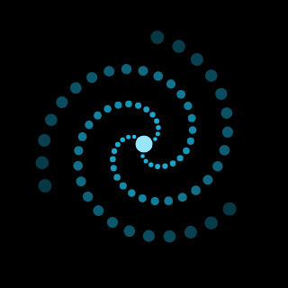
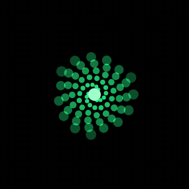
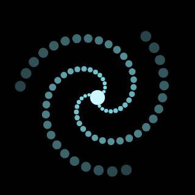
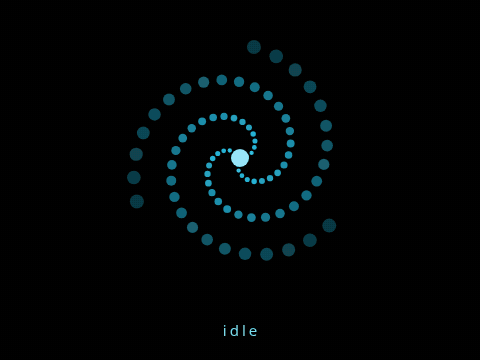
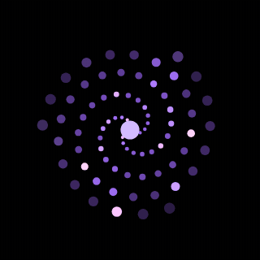

# The vortex face

The face every VorteX client with a screen shows: dots on three spiral arms that change their look with what the client is doing. This page is the specification. A new device type should be able to draw the same face from it alone.

Two implementations exist and must stay in step with this page and with each other:

- `firmware/waveshare-amoled-1.8/src/vortex.cpp` (the original, C++, RGB565 into a 240 by 240 buffer)
- `web/vortex.js` (a port, canvas)

Two more copies draw it on computers and follow the same settings (`idleLooksOff`, `toolIcons`, `toolIconMs`, `toolIconDots`): `clients/windows-desktop/Axis.Desktop.Core/Face.cs` and `clients/macos-desktop/Sources/AxisDesktopCore/Face.swift`, each a line-for-line port of `web/vortex.js`.

A change to a number or a rule goes into this page and both files in the same commit. Keep the two computer copies in step too.

Nothing is streamed as pixels: each client draws the face itself from the turn state Axis sends.

## 1. The model

The face is one drawing routine and a set of **looks**. A look is thirteen numbers. The face always holds a **current** look and a **target** look; every frame the current look moves part of the way to the target, and the dots are drawn from the current look. A change of state only ever changes the target.

| Field | Meaning | Unit |
| --- | --- | --- |
| `spin` | How fast the figure turns. Negative turns the other way. | radians per second |
| `radius` | How much of the drawing area the figure fills. | 0 to 1 |
| `twist` | How far the arms wrap around the centre. | turns |
| `pulse` | How much the figure breathes in and out. | 0 to about 0.3 of the radius |
| `pulseHz` | How fast it breathes. | per second |
| `wander` | How far the centre drifts. | pixels (of the 240 grid) |
| `sparkle` | Chance per dot per frame of a bright flash. | 0 to 1 |
| `dot` | Multiplier on dot size. | |
| `r`, `g`, `b` | Colour. | 0 to 1 each |
| `wave` | How far the arms sway from side to side. 0 for most looks. | radians at the tip of an arm |
| `tilt` | How far the figure is tipped away from the viewer. 0 is flat on. | 0 to about 0.6 |

## 2. The looks

There are 20: 14 idle looks and 6 state looks. Values are exact; copy them.

### Idle looks

The face drifts between these at random while nothing is happening.

| Name | spin | radius | twist | pulse | pulseHz | wander | sparkle | dot | r | g | b |
| --- | --- | --- | --- | --- | --- | --- | --- | --- | --- | --- | --- |
| calm | 0.50 | 0.85 | 0.90 | 0.03 | 0.25 | 0 | 0 | 1.0 | 0.10 | 0.78 | 0.95 |
| breathe | 0.35 | 0.80 | 0.80 | 0.20 | 0.18 | 0 | 0 | 1.1 | 0.15 | 0.60 | 1.00 |
| unwind | -0.40 | 0.95 | 1.25 | 0.04 | 0.30 | 0 | 0 | 0.9 | 0.20 | 0.85 | 0.80 |
| open | 0.80 | 1.00 | 0.45 | 0.05 | 0.30 | 0 | 0 | 1.2 | 0.05 | 0.70 | 1.00 |
| curl | 1.10 | 0.58 | 1.70 | 0.05 | 0.40 | 0 | 0 | 0.9 | 0.30 | 0.55 | 1.00 |
| drift | 0.45 | 0.75 | 1.00 | 0.04 | 0.25 | 14 | 0 | 1.0 | 0.10 | 0.85 | 0.85 |
| shimmer | 0.30 | 0.88 | 1.10 | 0.03 | 0.25 | 0 | 0.035 | 1.0 | 0.35 | 0.75 | 1.00 |

Seven more idle looks were added on 2026-10-09. They also use `wave` and `tilt`; every look above, and every state look, has both at 0.

| Name | spin | radius | twist | pulse | pulseHz | wander | sparkle | dot | r | g | b | wave | tilt | Reads as |
| --- | --- | --- | --- | --- | --- | --- | --- | --- | --- | --- | --- | --- | --- | --- |
| galaxy | 0.60 | 0.95 | 1.15 | 0.03 | 0.25 | 0 | 0.012 | 0.95 | 0.40 | 0.65 | 1.00 | 0 | 0.55 | a disc seen at an angle, a few stars |
| tendril | 0.25 | 0.90 | 0.70 | 0.04 | 0.30 | 0 | 0 | 1 | 0.10 | 0.90 | 0.75 | 0.45 | 0 | arms that ripple like something under water |
| bloom | 0.20 | 0.70 | 0.35 | 0.14 | 0.22 | 0 | 0 | 1.6 | 0.25 | 0.70 | 1.00 | 0 | 0 | big soft dots, opening and closing like a flower |
| pinwheel | 1.40 | 0.92 | 0.18 | 0.03 | 0.30 | 0 | 0 | 0.8 | 0.10 | 0.80 | 1.00 | 0 | 0 | nearly straight arms, turning briskly |
| deep | 0.28 | 0.66 | 1.40 | 0.10 | 0.15 | 8 | 0 | 1.15 | 0.10 | 0.40 | 1.00 | 0.2 | 0.25 | small, dark blue, slow |
| orbit | 0.90 | 1.00 | 0.50 | 0.03 | 0.30 | 0 | 0 | 1.1 | 0.15 | 0.75 | 0.95 | 0 | 0.45 | a tilted wheel, like rings |
| sway | 0.10 | 0.85 | 0.95 | 0.05 | 0.20 | 0 | 0 | 1 | 0.20 | 0.85 | 0.90 | 0.7 | 0 | hardly turning, arms swaying from side to side |

Idle looks stay in blues and blue-greens on purpose: green means listening, violet thinking, amber setup, red an error and grey offline, and an idle look must not be mistaken for one of those.

### State looks

| Mode | spin | radius | twist | pulse | pulseHz | wander | sparkle | dot | r | g | b | Reads as |
| --- | --- | --- | --- | --- | --- | --- | --- | --- | --- | --- | --- | --- |
| setup | 0.30 | 0.70 | 0.90 | 0.10 | 0.30 | 0 | 0 | 1.0 | 1.00 | 0.65 | 0.10 | amber, waiting to be set up |
| offline | 0.18 | 0.55 | 1.10 | 0.03 | 0.20 | 0 | 0 | 0.9 | 0.30 | 0.34 | 0.42 | small, slow, grey |
| listening | 1.60 | 0.45 | 1.80 | 0.08 | 1.20 | 0 | 0 | 1.2 | 0.15 | 1.00 | 0.55 | pulled in tight, green |
| thinking | 4.60 | 0.78 | 1.30 | 0.05 | 0.90 | 0 | 0.02 | 0.9 | 0.62 | 0.40 | 1.00 | fast, violet, a little sparkle |
| speaking | 1.10 | 0.78 | 0.75 | 0.22 | 2.40 | 0 | 0 | 1.2 | 0.55 | 0.95 | 1.00 | open, pulsing, white-blue |
| error | 0.15 | 0.62 | 0.70 | 0.12 | 0.50 | 5 | 0 | 1.0 | 1.00 | 0.18 | 0.12 | slow, red, the centre trembles |

At start-up the current and target looks are both `offline`.

## 3. Drawing one frame

All sizes are in a 240 by 240 grid (`SIZE`); scale to the real screen. `dt` is the time since the last frame in seconds, **capped at 0.1** so a stall never makes the face jump.

**Step 1: move towards the target.** For each of the thirteen fields:

```
k = 1 - exp(-dt * rate)        rate = 1.2 in idle, 5.0 in every other mode
now.field += (target.field - now.field) * k
```

Leaving idle feels immediate (about 0.2 s); drifting between idle looks is slow (about 1 s).

**Step 2: advance the clocks.**

```
phase       += now.spin * dt
pulsePhase  += now.pulseHz * 2π * dt
wanderPhase += 0.6 * dt
wavePhase   += 1.3 * dt
tiltPhase   += 0.15 * dt
```

**Step 3: the centre.**

```
cx = SIZE/2 + now.wander * sin(wanderPhase)
cy = SIZE/2 + now.wander * sin(1.7 * wanderPhase + 1)
```

**Step 4: the dots.** 3 arms, 26 dots per arm, `MAX_RADIUS = SIZE/2 - 14` (106). Clear the frame to black. For each arm `a` (0 to 2), draw dots `i` from **25 down to 0** (outer dots first, so the bright inner ones end up on top), with `t = (i + 1) / 26`:

```
spark: if random() < now.sparkle then spark[a][i] = 1;  then spark[a][i] *= 0.86   (every frame)

swell  = voiced ? voiceSwell * level : now.pulse * sin(pulsePhase - 3t)
radius = MAX_RADIUS * now.radius * (1 + swell) * t^0.85
angle  = phase + a * 2π/3 - now.twist * 2π * t + now.wave * t * sin(wavePhase - 7t)
glow   = min(1, 1 - 0.72t + spark)
colour = (now.r * glow + spark * 0.5,  now.g * glow + spark * 0.5,  now.b * glow + spark * 0.5), each clamped to 0..1
size   = now.dot * (1.4 + 4.2t)                         (radius of the dot)
x, y   = radius * cos(angle), radius * sin(angle)
along  = x * cos(tiltPhase) + y * sin(tiltPhase)
across = (y * cos(tiltPhase) - x * sin(tiltPhase)) * (1 - now.tilt)
filled circle at (cx + along * cos(tiltPhase) - across * sin(tiltPhase),  cy + along * sin(tiltPhase) + across * cos(tiltPhase))
```

The sway (`wave`) travels out along each arm and is widest at the tip. The tilt squashes the figure along one axis, as a disc looks when tipped away, and that axis turns slowly (`tiltPhase`), so the disc seems to wobble. With `wave` and `tilt` at 0 both lines change nothing.

The `- 3t` in the breathing wave makes it reach each dot a little later than the one inside it, so it ripples outward instead of throbbing as one.

**Step 5: the core**, drawn last, over the dots:

```
core   = 7 + (listening ? 6 : 3) * (voiced ? level : sin(pulsePhase))
colour = (0.55 + now.r * 0.45, 0.55 + now.g * 0.45, 0.55 + now.b * 0.45)
filled circle of radius core at (cx, cy)
```

## 4. The voice

`level` is the loudness of a voice, 0 to 1, or negative when none is known.

- `voiced` is true when the mode is listening or speaking **and** `level >= 0`. Then the voice drives the swell instead of the breathing wave.
- `voiceSwell` is **0.4** when listening (that look barely breathes on its own, so it needs a bigger swing) and the look's own `pulse` when speaking.
- While listening, `level` is the microphone; while the device is playing speech, the speech being played; otherwise `-1`.

How a level is measured matters as much as the face: raw loudness shakes from frame to frame. Every implementation follows these rules:

1. **Above the room.** The microphone level is how far the voice is above the room's own background level, so a fan or a hum does not move the face. Track the room level quickly downwards and slowly upwards.
2. **Square-root shaped.** `level = sqrt(clamp((loudness - room * 1.3 - floor) / range))`, so ordinary speech fills most of the range.
3. **Rise fast, fall over about a tenth of a second.** The face follows syllables without flicker.
4. **Speech is measured before the volume is applied**, so turning the volume down does not shrink the face.

What each implementation uses:

| | Board (`mic.cpp`, `speaker.cpp`) | Web (`client.js`) |
| --- | --- | --- |
| Microphone, per | 10 ms block, mean absolute value of int16 samples | 20 ms batch, RMS of float samples |
| Room level | down by 1/16, up by 1/1024 of the difference per block | down 30 %, up 0.5 % of the way per batch |
| Shape | `sqrt(clamp((avg - room*1.3 - 20) / 1500))` | `sqrt(clamp((rms - room*1.3 - 0.002) / 0.08))` |
| Speech | peak of each chunk written to the codec / 14000 | RMS from an analyser after the volume, × 5 |
| Smoothing | rise at once; fall `x*0.9 + new*0.1` per block (mic), `x*0.82 + new*0.18` per chunk (speech) | rise in about 30 ms, fall with a 100 ms time constant, per frame |

(The web speech level is taken after the volume; it should move before it, as rule 4 says. Small, known difference.)

## 5. Which look when

Checked in this order; the first that applies wins.

| Condition | Mode |
| --- | --- |
| Not set up: no Wi-Fi to join, or not paired | setup |
| Starting, joining Wi-Fi, pairing, or not connected to Axis | offline |
| The device is recording (it starts before Axis confirms a wake), or the turn state is `listening` | listening |
| Turn state `transcribing` or `thinking` | thinking |
| Turn state `speaking`, or speech is still coming out of the speaker after Axis says the turn is over | speaking |
| Turn state `error` | error (the board until the next state; the web client for 5 s) |
| Anything else | idle |

**Idle looks can be switched off.** The setting `idleLooksOff` holds the names of idle looks to leave out, separated by commas (spaces and letter case do not matter; unknown names are ignored). It is one of Axis's own settings, so it reaches every client through the ordinary settings sync and can differ per type or device; the admin Face page edits the value all devices share. A client never picks a look named there, moves off one at once if it is showing when the setting arrives, and keeps the first idle look if every one is named.

**Idle never loops.** Entering idle picks an idle look at random. Each lasts a random 7 to 17 seconds, then another is picked at random, never the same one twice in a row.

## 6. Per-device freedom

These may differ between devices; everything else above should not.

- **Drawing size and placement.** The board draws 240 by 240 over text, and with the screen to itself 240, 264 or 288 by its `idleFace` setting (the 1.8 since 0.20.0; the round 1.75 draws 288 by 288 over text, every size scaled by 1.2: `VORTEX_SIZE` in its build flags, and with the screen to itself 288, 360 or 380 by its `idleFace` setting, shrinking to 288 as it slides up for text: `vortex::setSize`, up to `VORTEX_MAX_SIZE`) and slides the face up to make room for text; the web page scales it to the window and shrinks it a little when words appear. Every size in the face is drawn to its scale, so a different size is the same face.
- **How overlaps mix.** The board paints dots over each other; the web adds their light (`lighter`), closer to how the panel glows. Either is fine.
- **Frame rate.** Anything from about 30 fps up. Sparkle fades per frame (`× 0.86`), so it fades a little faster at higher rates; acceptable.
- **Reduced motion.** A client that knows the person asked for less motion may turn the face at 30 % speed and drop sparkle, as the web client does.
- **A small or limited screen** (for example a watch with few colours) may use fewer dots per arm and the nearest colours it has, keeping the looks, the easing and the rules.

## 6a. Seeing the looks

The four states a person sees most, drawn by `web/vortex.js` (`media/`, made by `node scripts/make-face-gifs.mjs`; run it again when a look or a rule on this page changes):

| Idle | Listening | Thinking | Speaking |
| --- | --- | --- | --- |
|  |  |  |  |



The thinking face while the agent picks up a tool (section 8): the dots form a house, then a magnifier, and swirl back.



In the clips the voice is made up (syllables with pauses between words), measured the way section 4 says; a real device follows the microphone or the speech being played.

The admin page has a Face page (`#face`) that draws every look live with `web/vortex.js`: a tile per look, and the chosen one large beside its thirteen numbers, with a slider standing in for the voice on the two looks that follow one. It reads the looks straight from `web/vortex.js` (`IDLE`, `LOOKS`, `LOOK_FIELDS`, and `Vortex.hold()` to keep a face on one look), so a look added there shows up without touching the page. It is a viewer only: the looks are still code, in `web/vortex.js` and in the firmware.

## 7. Adding a look or a mode

- A new idle look is a row in one of the idle tables here and in both implementations. Keep its colour in the blues and blue-greens.
- A new mode needs a row in the state table, a line in section 5, and a turn state or client condition that selects it.
- Keep the voice rules in section 4 for any mode that follows a voice.

## 8. What the agent is doing

While the face is `thinking`, Axis may name the kind of work the agent has picked up (`doing` on the `turn` message). The face then shows an icon for it in the middle, in place of the core. Outside `thinking` there is never an icon.

**The icons.** Thirteen: `search`, `web`, `home`, `calendar`, `list`, `files`, `code`, `timer`, `message`, `memory`, `image`, `computer`, `tool`. Each is a few strokes (lines through points) on a 24 by 24 grid, drawn with a round pen. They are defined once, in `web/icons.js`; `node scripts/gen-icons.mjs` writes `firmware/waveshare-amoled-1.8/src/icons.h`, the Windows desktop app's `FaceIcons.g.cs` and the Mac app's `FaceIcons.g.swift` from it, with circles already cut into straight pieces. Change an icon there and run the script; never edit the header.

**Each frame**, before step 2:

```
want       = (mode is thinking and an icon is set) ? 1 : 0
iconShown += (want - iconShown) * (1 - exp(-dt * 6))
eye        = iconShown < 0.01 ? 0 : iconShown > 0.985 ? 1 : iconShown
hole       = 36 * eye
```

The icon last set stays the one drawn while it fades out, so a change of mode never shows a half-drawn nothing.

**The arms stand back.** In step 4 the radius of a dot becomes

```
reach  = MAX_RADIUS * now.radius * (1 + swell)
radius = hole + max(0, reach - hole) * t^0.85
```

With `hole` 0 this is the line step 4 already has. With an icon up, the innermost dots sit on a ring of radius 36 round it and the outer ones barely move.

**The icon**, in step 5: the core is drawn at `core * (1 - eye)` (not at all when `eye` is 1). Then the icon, centred on `(cx, cy)`, in the core's colour at brightness `eye`, in a square of side `52 * (1 + 0.04 * sin(pulsePhase))`, with a pen 3.4 wide. A point `(x, y)` of the grid lands at `cx + (x - 12) * side / 24`, the same for `y`. The vortex has no top and a device may send it to its panel unturned; the icon has one, so a device that turns its screen turns the icon with it (`vortex::setRotation` on the board).

### The same icons in dots

The setting `toolIcons` says how an icon is shown: `dots` (the default, and what anything unknown means), `line` (everything above in this section) or `off` (`want` is always 0). The style last shown stays the one drawn while an icon fades out.

In `dots` there is no pen and no hole (`hole = 0`): the face's own 78 dots draw the icon. `iconDots` in `web/icons.js` sets 78 points evenly along the icon's strokes, each stroke getting its share by length and at least one; the generator writes them into `icons.h` as `SHAPES`. Dot `i` of arm `a` goes to point `n = i * 3 + a`, so the three arms take turns along the strokes.

Before the dots, each frame:

```
flowPhase += 5 * dt
unit   = 150 / 24 * (1 + 0.05 * sin(pulsePhase))          the shape fills a square of side 150 and breathes
sway   = 0.07 * sin(wavePhase)                            and turns a little from side to side
shade  = (0.55 + now.colour * 0.45) * 0.6 + tint * 0.4     the core's colour, leaning to the kind's tint (ICON_TINTS)
```

Then for each dot, after its place on the arm `(px, py)`, its `size` and its colour are worked out as in step 4:

```
(ix, iy) = point n, less (12, 12), times unit, turned by sway
px   += (SIZE/2 + ix - px) * eye              the straight way from the arm to the icon
py   += (SIZE/2 + iy - py) * eye
size += (2.9 - size) * eye
lit   = 0.62 + 0.38 * sin(flowPhase - 0.33 * n) + spark * 0.5
colour += (shade * lit - colour) * eye
```

The core is drawn at `core * (1 - eye)` as in the line style, and nothing is drawn over it. A device that turns its screen turns `(ix, iy)` the same way it turns the line icon.

### Tuning

Two settings, both shared like `toolIcons`:

- `toolIconMs` (150 to 3000, 700 when unset): how long an icon takes to form and to go. The `6` in `iconShown += (want - iconShown) * (1 - exp(-dt * 6))` is `4.2 * 1000 / toolIconMs`: easing covers all but the last sixtieth in 4.2 time constants, which is when `eye` snaps to 1.
- `toolIconDots` (12 to 78, 78 when unset): how many dots draw a dot shape. Dot `n = i * 3 + a` is in the shape when `n < toolIconDots`, which takes the inner dots of each arm first, and goes to point `floor(n * 78 / toolIconDots)` of the 78, so the shape is still covered end to end. The light's wave uses that point's number in place of `n`. A dot that is not in the shape stays on its arm, pushed out as the line style's hole pushes: `radius = 80 * eye + max(0, reach - 80 * eye) * t^0.85`. With all 78 in the shape nothing is left on the arms.

## 9. A run that is held up

While the face is `thinking`, `doing` may also name why the agent's run is not getting on with the answer. That is shown as a look, with no icon: the face goes to it the way it goes to any state look (rate 5.0), and back to `thinking` when `doing` says something else.

| doing | spin | radius | twist | pulse | pulseHz | wander | sparkle | dot | r | g | b | Reads as |
| --- | --- | --- | --- | --- | --- | --- | --- | --- | --- | --- | --- | --- |
| compacting | 0.90 | 0.42 | 2.40 | 0.14 | 0.50 | 0 | 0 | 1.0 | 0.35 | 0.55 | 1.00 | wound in tight, slow, deep blue: tidying its memory |
| retrying | -2.20 | 0.70 | 1.00 | 0.10 | 1.60 | 0 | 0 | 1.0 | 1.00 | 0.70 | 0.25 | amber, turning backwards: its provider failed and it is trying again |

`doing: "none"`, or any name the face has neither a look nor an icon for, is plain thinking.

